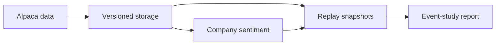

# MicroBroker

MicroBroker is a Python research and paper-trading prototype for studying how company news relates to short-horizon stock returns. It collects Alpaca market data and news, records when each input was available, analyzes company sentiment with local FinBERT, and replays saved inputs to produce auditable reports.

**R30 (0.30.0)** · Python 3.11+ · [Türkçe kullanım rehberi](docs/KULLANIM.md) · [Event-study methodology](docs/EVENT_STUDY.md)

## Try the demo

From the project folder, on macOS or Linux:

```bash
python3 -m venv .venv
source .venv/bin/activate
python -m pip install .
microbroker verify-event-study
microbroker demo-event-study --output data/demo
cat data/demo/report.txt
```

The demo uses synthetic inputs and writes `report.txt` and `report.json`. It requires no Alpaca credentials, PostgreSQL server, or model download. The bundled scenario reports 3 eligible company events and 12 SPY-matched horizon results. Use a new output directory if you run it again.

## What the project demonstrates

| Area | Implementation |
| --- | --- |
| Data ingestion | Historical bars, WebSocket price receipts, and versioned company news |
| Research data | SQLite for local runs, PostgreSQL for concurrent collection, and replay snapshots with integrity checks |
| Analysis | Company-level sentiment with abstention when the text or model evidence is insufficient |
| Event study | +1/+5/+15/+60 minute simple returns in basis points, with a same-window SPY comparison |
| Paper trading | A separate strategy, risk, order reconciliation, and portfolio path for Alpaca Paper |



The event study uses the close of the first full minute starting at or after analysis availability. An analysis available at 15:00:10 uses the 15:01–15:02 bar close as its reference; the +1 minute result uses the 15:03 close. Missing or invalid price windows are reported separately. The SPY adjustment is a simple return difference. This is descriptive research; the results do not establish profitability or market execution quality.

## Verification

```bash
python -m pip install '.[stream]'
python -m unittest discover -s tests
```

[CI](.github/workflows/ci.yml) is configured to run the regression suite on Python 3.11 and 3.12, the synthetic demo, and a separate PostgreSQL 16 integration check using synthetic fixtures. See [validation status](docs/VALIDATION.md) for the runs observed before publication.

[Local Alpaca collection, PostgreSQL setup, and GitHub publishing steps](docs/KULLANIM.md) are separate from the demo. The research collection command `run-event-study-session` does not send orders. Live-market acceptance for R30 is pending.
